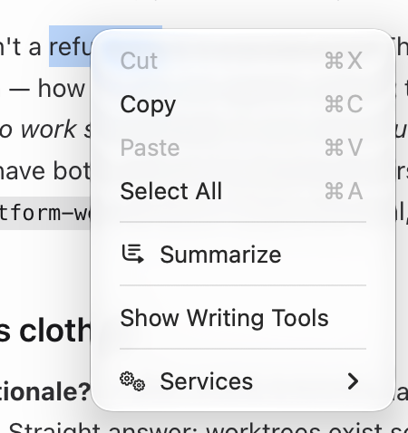
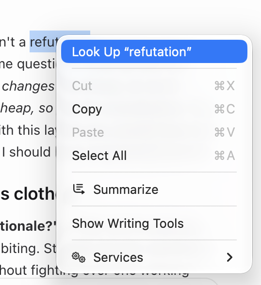
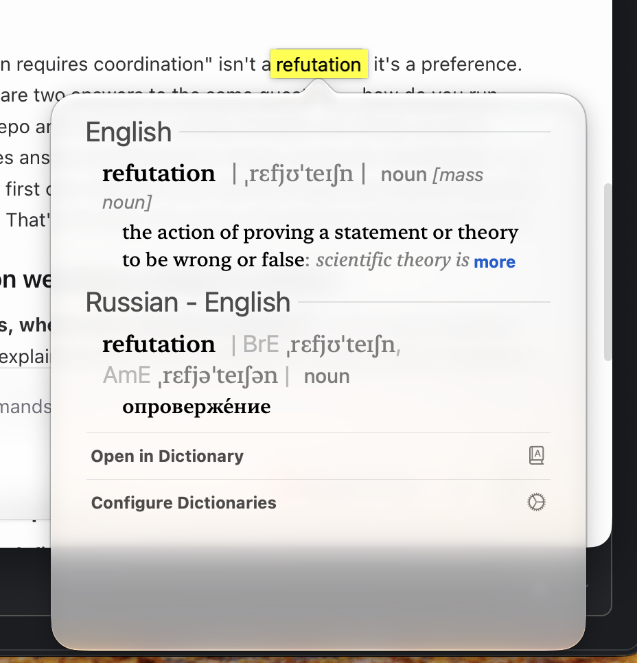

# look-up

Adds a **Look Up "word"** row to T3 Code's right-click menu, above Cut, shown only when something is
selected. It opens the macOS dictionary panel on the selection — the same Look Up the rest of the
system shows, not a detour through Dictionary.app.

```sh
./patch apply look-up
```

Quit T3 Code and open it again, select some text, right-click.

## Before and after

| Before | After |
| --- | --- |
|  |  |

Picking the row opens the macOS Look Up panel over the word, reading whatever dictionaries you
have turned on — here English plus Russian–English:



## What it changes

T3 Code builds this menu in its Electron main process, in the handler it installs for `webContents`'
`context-menu` event (`/apps/desktop/dist-electron/main.cjs`). The handler assembles a template —
Copy Link and Copy Image when the pointer was on one, then Cut, Copy, Paste, Select All — and pops
it up. macOS adds Summarize, Writing Tools and Services to it on its own.

The patch inserts one statement in front of the Cut entry:

```js
{
  const s = (params.selectionText || '').split(/\s+/).join(' ').trim()
  if (s) {
    menuTemplate.push(
      { label: `Look Up “${s.length > 24 ? `${s.slice(0, 24).trim()}…` : s}”`,
        click: () => { if (!contents.isDestroyed()) contents.showDefinitionForSelection() } },
      { type: 'separator' },
    )
  }
}
```

`params.selectionText` is Electron's own field on the `context-menu` event, and
[`webContents.showDefinitionForSelection()`](https://www.electronjs.org/docs/latest/api/web-contents#contentsshowdefinitionforselection-macos)
is the macOS-only call that raises the Look Up panel for whatever is selected in the page. Nothing
new is required of the app.

The slack comes from the handler's own indentation, between `const menuTemplate = [];` and the
`electronMenu.popupTemplate` call that ends it: 289 bytes on T3 Code 0.1.10, and the row costs 280.

## What it does not do

- **A selection is required.** macOS can look up the word under the pointer with no selection; the
  `context-menu` event only carries `selectionText`, so with nothing selected there is no row.
- **macOS only.** `showDefinitionForSelection` exists nowhere else.
- The label shows the first 24 characters of the selection, whitespace collapsed.

## The same change upstream

[upstream.patch](upstream.patch) is this change written against T3 Code's own source, in its own
idiom: `apps/desktop/src/window/DesktopWindow.ts`, in the `installContextMenu` handler, with the
label going through `m(msg(...))` so it can be translated and the whole block behind
`environment.platform === "darwin"`.

```sh
gh repo clone pingdotgg/t3code && cd t3code
git apply /path/to/upstream.patch
```

It is here so the idea can be read as a diff rather than a description. T3 Code does not take
outside feature PRs ([CONTRIBUTING.md](https://github.com/pingdotgg/t3code/blob/main/CONTRIBUTING.md)),
so it is filed as an idea instead:
[pingdotgg/t3code#38924](https://github.com/pingdotgg/t3code/discussions/38924).

## Anchor

`place()` finds `menuTemplate.push({ role: "cut"` by regular expression and walks back to
`const menuTemplate = [];`. If a future build renames either, `./patch apply` refuses and says the
anchor is gone rather than writing into the wrong place.
